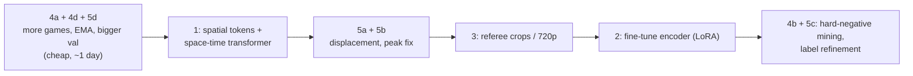

# Recommendations: pushing card spotting toward F1 ≈ 0.9

Date: 2026-10-08. Baseline for comparison: run `v1` (`runs/v1/best.pt`, epoch 13).

---

## 0. Diagnosis first: what is actually limiting v1

Measured on v1. These numbers come from the detections at all thresholds, not just the 0.70–0.95 grid.

| Split | Tolerance | Recall ceiling (any score) | Best F1 (any threshold) | P / R at best | thr |
|---|---|---|---|---|---|
| val (58 cards) | ±1 s | 0.690 | 0.468 | 0.611 / 0.379 | 0.75 |
| val | ±2 s | 0.983 | 0.617 | 0.806 / 0.500 | 0.75 |
| val | ±5 s | 1.000 | 0.691 | 0.731 / 0.655 | 0.70 |
| test (101 cards) | ±1 s | 0.683 | 0.419 | 0.395 / 0.446 | 0.60 |
| test | ±2 s | 0.960 | 0.540 | 0.509 / 0.574 | 0.60 |
| test | ±5 s | 1.000 | 0.615 | 0.705 / 0.545 | 0.70 |

**Peak score near each true card (±5 s):** test quantiles are p10 0.15, p25 0.46, median 0.72, p75 0.82, p90 0.87. About 15% of cards peak below 0.3.

What this says:

1. **The model is not too small. It overfits.** Train loss falls steadily (0.49 → 0.17). Val loss bottoms out at epoch 4 (0.22) and climbs to 0.32 by epoch 23. Val tight-mAP swings between 0.33 and 0.52 from epoch to epoch. A bigger temporal transformer on the same features would overfit faster. The bottleneck is **what the features contain** and **how much labelled data there is**, not capacity.
2. **The model fires near almost every card (96–98% within ±2 s), but scores are not separable.** True cards and false alarms overlap in the 0.4–0.85 range. That's a feature-quality problem: the model sees "stoppage around referee", not "card in hand".
3. **Peaks are capped around 0.87.** Soft Gaussian targets plus window averaging mean scores rarely pass 0.9. The required 0.70–0.95 threshold grid therefore removes recall structurally.
4. **±1 s is bounded by localization and label noise.** Even at any score, only 68–69% of cards have a peak within ±1 s. F1 ≈ 0.9 at ±1 s is not reachable without fixing timing. ±2 s and ±5 s are the realistic targets.
5. **Mean-pooling throws away the signal you care about.** Each frame is CLS plus the *average* of 448 patch tokens. A raised arm holding a small card covers a handful of patches, and averaging dilutes it to almost nothing.

> [!IMPORTANT]
> **Realistic target:** F1 ≈ 0.9 with balanced P/R at **±2–5 s** is a stretch but plausible after items 1–4. At **±1 s**, SoccerNet's own annotation jitter (~±1 s) puts a hard ceiling well below 0.9. I recommend fixing the success criterion as **F1 at ±2 s**.

---

## 1. Keep spatial information: patch tokens + space-time transformer (architecture overhaul)

**Problem:** mean-pooling 448 patch tokens into one vector erases small, local evidence (hand, card, raised arm).

**Change:**
- Cache DINOv2 patch tokens pooled to a **4×7 grid (28 tokens)** + CLS per frame, instead of one 768-d vector.
- Replace the temporal-only transformer with a **factorized space-time transformer**:
  - **Spatial block:** each frame's 29 tokens attend within the frame. This learns *where* the referee and hand are.
  - **Temporal block:** each spatial position attends across the 50 frames. This learns the *motion*: hand to pocket → arm up → hold.
  - A learned **attention-pool** collapses each frame to 1 token, then the existing frame and clip heads run on top.
- Model size: ~4–6M params. Still small, but now it has spatial evidence to work with.

**Cost:**
- Storage: 29 tok × 384 × 2 B ≈ 22 KB/frame. Train ≈ 16.2k clips × 90 frames × 2 flips ≈ 64 GB, eval halves ≈ 47 GB, so **≈ 111 GB total** (400 GB free). An 8×14 grid would be ~440 GB, which doesn't fit.
- Re-extraction: ~2.5 h. Decoding dominates, same as before.

**Why it targets your goal:** "referee pulling out and showing the card" is a *localized spatial event evolving over time*. This is the minimal architecture that can represent it.

**Expected effect:** the largest single gain in separability. FP and TP score distributions should pull apart.

---

## 2. Fine-tune the frame encoder end-to-end

**Problem:** frozen DINOv2 is generic. It was never taught that "a small yellow/red rectangle in a raised hand" matters.

**Option A (recommended): LoRA on DINOv2-S, last 4 blocks + the space-time head from item 1.**
- Train on raw 224p frames. Cache decoded clips once as uint8 JPEG/npz (≈ 1.2k pos + ~6k neg × 50 frames ≈ 20–30 GB) so training doesn't re-decode video.
- Fits in 8 GB: ViT-S, gradient checkpointing, AMP, batch 4–8 clips × 50 frames, LoRA rank 16.
- ~1–2 h per epoch on the 4060 (estimate).

**Option B: E2E-Spot-style light 2D CNN** (RegNet-Y 200MF + temporal shift + GRU, trained end-to-end at 10 fps).
- This is a *per-frame 2D CNN*, not a heavy video backbone, and it's the family that holds strong precise-spotting results on SoccerNet at 224p.
- Cheaper than ViT LoRA and naturally precise in time.

**Risk:** more overfitting with only 1.2k positives. That's why item 4 (more data) should land first or together with this.

**Expected effect:** the encoder learns the card and gesture appearance directly. This is the main lever for precision at high thresholds.

---

## 3. Give the model more pixels where the card is

**Problem:** at 224p the card is a few pixels in wide shots, larger only in close-ups. Some cards are physically unresolvable.

**Change (pick one or both):**
- **720p source:** SoccerNet distributes HQ (720p) videos under its NDA. Download them for the train games plus the 40 held-out games. Run the encoder at 448×784 (patch-14 grid 32×56). Pool to the same 4×7 token grid for storage, or crop (below).
- **Referee/person crop stream:** run a person detector (e.g. `ultralytics` YOLO, nano or small) per frame. Take the top-k person crops (k = 2–3, biased toward the largest or most central person and toward referee kit colour). Encode each crop with DINOv2 and add them as extra tokens per frame alongside the global tokens.
  - This directly feeds the model "the person who might be holding a card", at higher effective resolution.
  - It works even on 224p sources: crops get upsampled, but they're centred on the right thing.

**Cost:** detector pass ≈ 1–2 h; 720p download ≈ hundreds of GB (check disk before downloading).

**Expected effect:** fixes the ~15% of cards that peak below 0.3, which are likely wide shots where the card isn't visible at the current resolution.

---

## 4. More and better training data

**4a. Use the 160 unused games.** Official `valid` and `test` each have 100 games, and only 20 of each are held out. Moving the remaining **80 + 80 = 160 games into training** grows train from 300 to 460 games, about **+50% positives (~1.2k → ~1.8k)**. The 40 held-out games stay untouched.
- Trade-off: results are no longer comparable to the official SoccerNet benchmark split. That's irrelevant for this project's goal.
- This is the cheapest big win given the measured overfitting. One config change plus extraction for the new games (~45 min).

**4b. Iterative hard-negative mining.** Run the model over full train halves. Collect high-scoring false alarms ≥60 s from any card, and add them to the negative pool for the next round.
- Current negatives are rule-based (random / foul / stoppage). The model's own FPs are the most informative negatives.
- 2–3 rounds is typical. Needs full-half features for train games, either ~0.8M frames for the subsample used for mining or all 600 train halves (~16M frames, ~5–6 h).

**4c. Stronger temporal augmentation:** speed perturbation (resample 0.8–1.25×), random temporal crops with partial gestures, mixup between negatives and positives with soft labels, cutout of contiguous frame spans.

**4d. Regularize training:** EMA of weights (or SWA over the last N epochs) plus label smoothing on the clip head. v1's val metrics swing ±0.1 epoch to epoch, so EMA alone should stabilize the selected checkpoint.

**Expected effect:** directly attacks the overfitting seen in v1. It's a prerequisite for items 1–2 to pay off.

---

## 5. Fix localization, targets, thresholds and the evaluation itself

**5a. Re-add the displacement head (now justified by data).** The ±1 s recall ceiling is only 68%, while ±2 s is 96–98%. The model is near the card but off by 1–2 s. A confidence + displacement head with voting sharpens peaks. Ablate it against no displacement.

**5b. Make peaks reach high confidence.**
- Peaks currently cap around 0.87, so a 0.70–0.95 grid structurally cuts recall.
- Use a **hard positive core** (target = 1 for |t − c| ≤ 3 frames) with a Gaussian shoulder outside it, instead of a pure Gaussian.
- Score each detection by **max** (not average) of window outputs at the peak frame.
- Either extend the threshold grid down to 0.3, or calibrate so true peaks land in your 0.70–0.95 range. I recommend extending the grid: the best-F1 thresholds measured on test were 0.60–0.70.

**5c. Label timestamp refinement.** SoccerNet timestamps aren't the exact "card shown" frame. Option A: self-training. Snap each training label to the model's peak within ±1.5 s, only when confident, then retrain. Option B (more reliable): hand-annotate the gesture moment for the ~1.8k train cards with a small clip-review tool. At ~5 s per card that's about 2.5 h.

**5d. Evaluate on more cards.** Val has only 58 cards, so the standard error on F1 is roughly ±0.06. That's why tight-mAP jumped 0.33–0.52 between adjacent epochs, and `best.pt` selection is partly noise.
- Recommend **≥150 val cards**: ~50 val games, or 5-fold game-level CV on train for model selection.
- Extraction for 30 extra val games ≈ 45 min.

**Expected effect:** reliable model selection, ±1 s and ±2 s gains from sharper peaks, and thresholds that actually match your requested range.

---

## Suggested order

1. **Cheap foundations:** 4a (more data), 4d (EMA), 5d (bigger val). Retrain the v1 architecture to get an honest new baseline.
2. **Item 1:** the biggest architectural gain, still with frozen features.
3. **Items 5a / 5b:** localization and peak shape.
4. **Item 3:** more pixels on the referee.
5. **Item 2:** end-to-end fine-tuning once the data and architecture are right.
6. **Items 4b / 5c:** iterative polish.

Each step gets its own run name, its own changelog entry, and comparison against the previous best on the same held-out games.

## What I would not do
- **Scale up the current temporal transformer** (more layers, more heads). v1 already overfits by epoch 4–5.
- **Raise the frame rate.** 10 fps is enough for a 1–2 s gesture, and you confirmed it.
- **Lengthen the window.** That reintroduces the foul context you explicitly want excluded.
